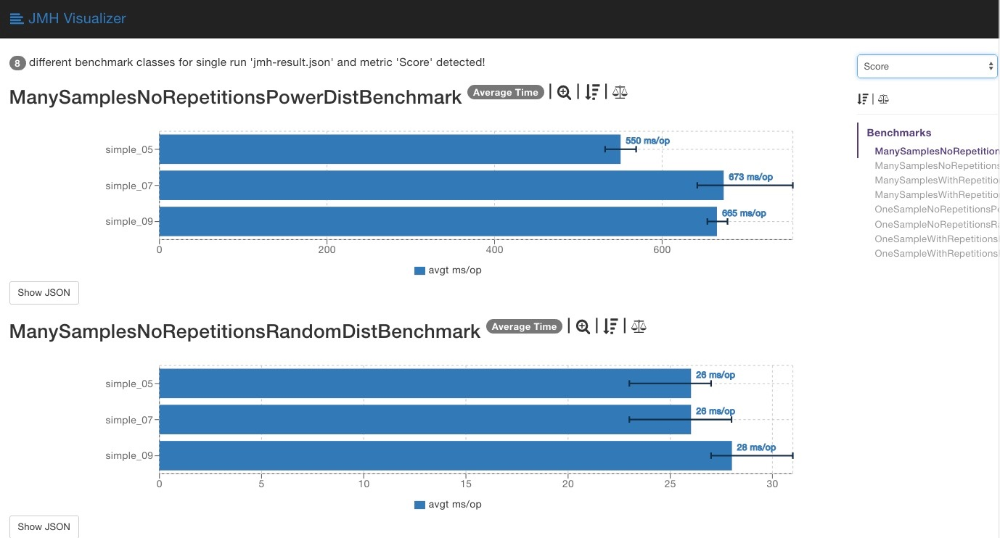

# 🎲 Weighted Lottery

[](https://maven-badges.herokuapp.com/maven-central/io.github.guyko/WeightedLottery)
[](https://github.com/guyko/weighted-lottery/blob/master/LICENSE)
[](https://kotlinlang.org/)
[](https://openjdk.org/)

> **High-performance, battle-tested weighted random sampling library for JVM**

Weighted Lottery is a collection of optimized algorithms for weighted random sampling (also known as weighted random selection or probability-based selection). Choose items randomly according to their assigned probabilities, with or without replacement.

## ✨ Features

- 🚀 **Multiple optimized algorithms** - Choose the best one for your use case
- ⚡ **High performance** - Extensively benchmarked with JMH
- 🔧 **Flexible** - Supports sampling with and without replacement  
- 📊 **Battle-tested** - Used in production systems
- 🎯 **Type-safe** - Written in Kotlin with Java interoperability
- 🏗️ **Zero dependencies** - Lightweight and self-contained

## 🚀 Quick Start

### Maven
```xml
<dependency>
    <groupId>io.github.guyko</groupId>
    <artifactId>WeightedLottery</artifactId>
    <version>1.0.2</version>
</dependency>
```

### Gradle
```kotlin
implementation("io.github.guyko:WeightedLottery:1.0.2")
```

## 💡 Usage Examples

### Basic Weighted Sampling
```kotlin
// Define weights for 5 items
val weights = doubleArrayOf(0.15, 0.0, 0.2, 0.0, 0.65)
val lottery = SimpleIntWeightedLottery(weights)

// Draw 10 samples (with replacement)
repeat(10) {
    val selectedIndex = lottery.draw()
    println("Selected item at index: $selectedIndex")
}
```

### Sampling Without Replacement
```kotlin
val weights = doubleArrayOf(0.3, 0.2, 0.5)
val lottery = SimpleIntWeightedLotteryNoRepetitions(weights)

// Draw all items until exhausted
while (!lottery.empty()) {
    val selectedIndex = lottery.draw()
    println("Selected: $selectedIndex, remaining: ${lottery.remaining()}")
}
```

### Use Cases
- **A/B Testing** - Route users to experiments based on traffic allocation
- **Load Balancing** - Distribute requests across servers by capacity
- **Game Development** - Item drops, character selection, procedural generation
- **Recommendation Systems** - Sample items based on relevance scores
- **Monte Carlo Simulations** - Weighted random sampling in statistical models

## 🏎️ Performance Comparison

All implementations are rigorously benchmarked using JMH. Choose the best algorithm for your specific use case:



**[🔗 Interactive Benchmark Results](https://jmh.morethan.io/?source=https://raw.githubusercontent.com/guyko/weighted-lottery/master/jmh-result.json)**

### Algorithm Comparison

| Algorithm | Best For | Time Complexity | Space Complexity |
|-----------|----------|-----------------|------------------|
| `SimpleIntWeightedLottery` | Small datasets, simple use cases | O(n) | O(n) |
| `AliasLottery` | Large datasets, frequent sampling | O(1) | O(n) |
| `SumTreeLottery` | Dynamic weights, frequent updates | O(log n) | O(n) |
| `ReservoirLottery` | Sampling without replacement | O(k) | O(k) |

## 🛠️ Available Implementations

### With Replacement (samples can repeat)
- **`SimpleIntWeightedLottery`** - Binary search on cumulative weights
- **`AliasLottery`** - Walker's alias method for O(1) sampling
- **`TwistedAliasLottery`** - Optimized alias method variant
- **`SumTreeLottery`** - Binary tree for dynamic weight updates
- **`UniformLottery`** - Uniform distribution (all weights equal)

### Without Replacement (each item drawn once)
- **`SimpleIntWeightedLotteryNoRepetitions`** - Removes selected items
- **`AliasLotteryNoRepetitions`** - Alias method with item removal
- **`ReservoirLottery`** - Reservoir sampling algorithm

## 🔬 Advanced Usage

### Custom Random Source
```kotlin
val lottery = SimpleIntWeightedLottery(
    weights = weights,
    random = { ThreadLocalRandom.current() }
)
```

### Error Handling
```kotlin
try {
    val index = lottery.draw()
} catch (e: NoSuchElementException) {
    println("No more items to draw")
}
```

## 🧪 Running Benchmarks

```bash
# Run all benchmarks (takes several hours)
cd WeightedLottery-benchmark
mvn exec:java -Dexec.mainClass="com.wl.benchmark.WeightedLotteryBenchmarkKt"

# Results saved to jmh-result.json
# Visualize at: https://jmh.morethan.io/
```

## 📚 Documentation

- **[📖 Wiki](https://github.com/guyko/weighted-lottery/wiki)** - Detailed documentation and examples
- **[🔬 Benchmark Details](WeightedLottery-benchmark/src/test/java/com/wl/benchmark/README.md)** - Understanding performance tests
- **[📊 API Documentation](https://javadoc.io/doc/io.github.guyko/WeightedLottery)** - Complete API reference

## 🤝 Contributing

Contributions are welcome! Please feel free to submit a Pull Request. For major changes, please open an issue first to discuss what you would like to change.

1. Fork the repository
2. Create your feature branch (`git checkout -b feature/amazing-feature`)
3. Add tests for your changes
4. Run the test suite (`mvn test`)
5. Commit your changes (`git commit -am 'Add amazing feature'`)
6. Push to the branch (`git push origin feature/amazing-feature`)
7. Open a Pull Request

## 📄 License

This project is licensed under the Apache License 2.0 - see the [LICENSE](LICENSE) file for details.

## ⭐ Support

If this library helped you, please consider giving it a star! ⭐

## 📞 Contact

- **Author**: Guy Kobrinsky
- **LinkedIn**: [guykobrinsky](https://linkedin.com/in/guykobrinsky)
- **Email**: guy.kobrinsky@gmail.com

---

<div style="text-align: center;">
  
**Built with ❤️ for the JVM community**

[⭐ Star this repo](https://github.com/guyko/weighted-lottery) | [🐛 Report Bug](https://github.com/guyko/weighted-lottery/issues) | [💡 Request Feature](https://github.com/guyko/weighted-lottery/issues)

</div>

